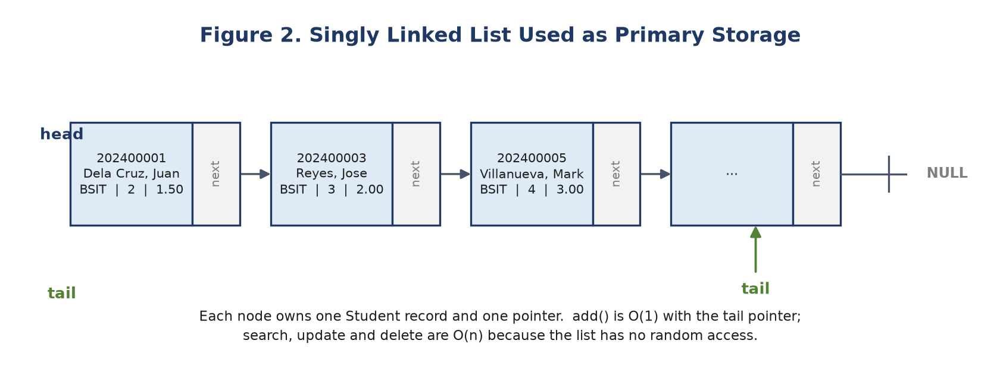
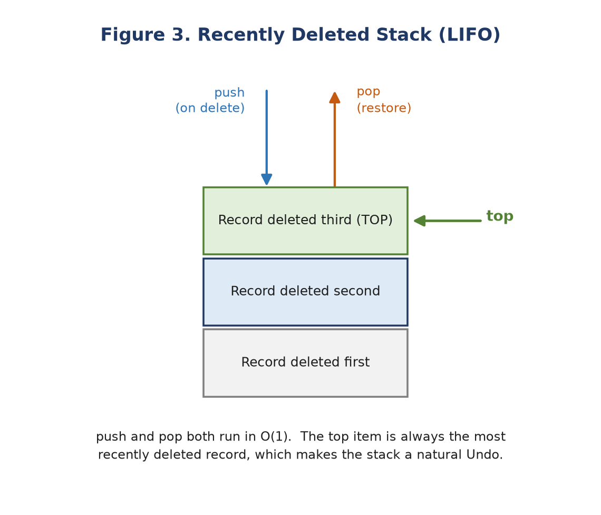
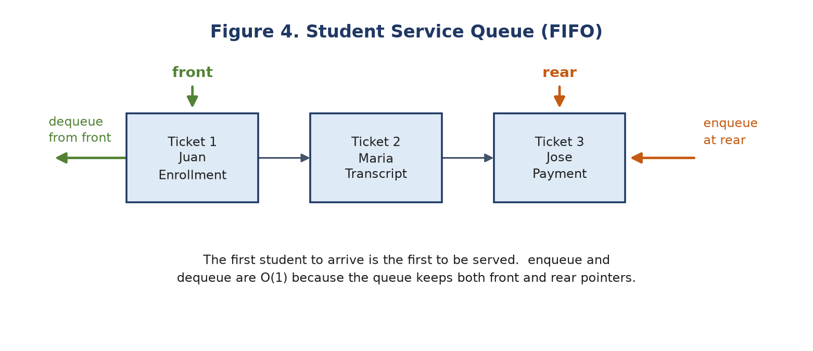
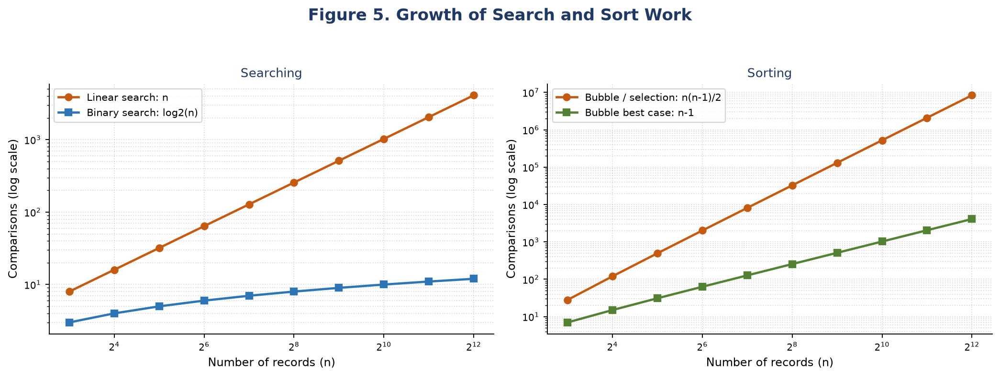
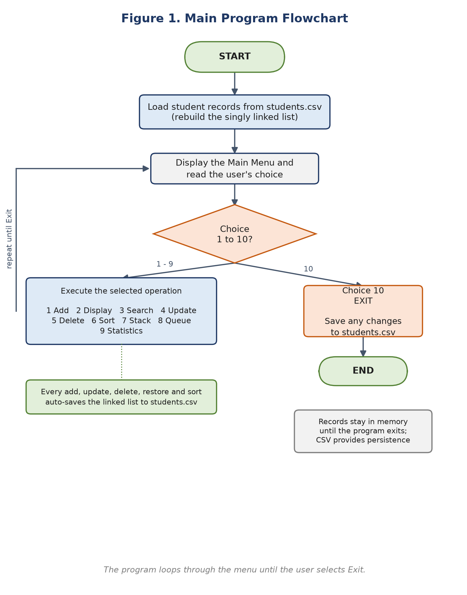

# Data Structure Algorithms — Student Record Management Documentation

**Group Name:** Group 7  
**Course/Section:** BSIT 2H  
**Project:** PLMun Student Record Management System (C++17)  
**Leader:** ______________________________

**Members:**

1. Henry Jr. Banaag
2. Janelle Maitim Mansumayog
3. Emmanuel Jacinto M. Medina
4. Jetlance Manguiob
5. Yuan Gabrielle Gatchalian

---

## Table of Contents

1. Introduction
2. Objectives
3. Problem Statement
4. Scope and Limitations
5. System Features
6. Data Structures Used
7. Algorithms Used
8. System Flowchart
9. C++ Source Code
10. Sample Outputs
11. Test Cases
12. Discussion
13. Conclusion
14. Recommendations
15. Appendices

---

## 1. Introduction

Student records are among the most frequently used data in a school. Enrolment
lists, class lists, grade reports, and student services all depend on the same
basic information: a student ID, a name, a course, a year level, and a grade
point average. When these records are kept on paper or in unstructured
spreadsheets, simple tasks become slow and error-prone. A clerk may add the same
student twice, lose a deleted record with no way to restore it, or scan an entire
sheet just to find one ID. There is also no natural way to model a line of
students waiting for service.

The **PLMun Student Record Management System** is a console-based application
written in C++17 that addresses these problems through a menu-driven interface.
It supports adding, displaying, searching, updating, and deleting student
records; sorting records by student ID, last name, or GPA; restoring recently
deleted records; and managing a first-come, first-served service queue. Records
are saved to a CSV file and loaded automatically the next time the program runs.

The project is also a hands-on application of the data structures and algorithms
covered in the course. Instead of storing records in one fixed-size array, the
system uses a **singly linked list** as its primary storage. A **stack** tracks
recently deleted records so that the most recent deletion can be undone. A
**queue** models the student service line. Searching is demonstrated with both
**linear search** and **binary search**, while sorting is demonstrated with both
**bubble sort** and **selection sort**. Recursion is used to count records and to
display them in reverse order. The program reports the number of comparisons and
swaps performed so that the theoretical trade-offs can be observed in actual
runs rather than only studied in theory.

---

## 2. Objectives

The project aims to:

1. Design and implement a working student record management system in C++ that
   supports adding, viewing, searching, updating, and deleting records.
2. Apply a **singly linked list** as the primary dynamic data structure, using
   pointers, dynamic memory allocation, and a destructor to release memory.
3. Implement and compare **linear search** and **binary search** for locating
   student records, including the number of comparisons each performs.
4. Implement and compare at least two sorting algorithms — **bubble sort** and
   **selection sort** — for organizing records by student ID, last name, and GPA.
5. Apply **stack (LIFO)** operations to a real use case: restoring recently
   deleted student records.
6. Apply **queue (FIFO)** operations to a real use case: a first-come,
   first-served student service line.
7. Implement **recursion**, specifically for counting the records in the linked
   list and for displaying them in reverse order.
8. Practice pointers, dynamic memory management, input validation, modular
   program design using classes and functions, and CSV file persistence.

---

## 3. Problem Statement

Manual and semi-structured methods of keeping student records do not scale well.
Paper lists and ordinary spreadsheets have no built-in logic for preventing
duplicate IDs, no undo for accidental deletion, and no efficient way to search or
sort a growing collection. A fixed-size array has a related problem: the maximum
number of records must be declared in advance, and inserting or deleting in the
middle requires shifting many elements.

The proposed system solves these problems by storing records in a dynamic linked
list, validating every input, and providing explicit operations for searching,
sorting, undo, and service queuing. It also saves the records to a file so that
the data is not lost when the program closes. The result is a small but complete
record management system that is easy to demonstrate and easy to extend.

---

## 4. Scope and Limitations

### Scope

- Console-based, single-user application written in standard C++17.
- Student records contain a numeric student ID, first name, last name, course,
  year level, and GPA on the PLMun 1.00–5.00 scale (1.00 is best).
- Add, display, search, update, delete, sort, undo, queue, and statistics
  operations.
- Persistent storage in `students.csv`.
- Input validation for IDs, names, courses, year levels, and GPA.
- Comparison counts for linear/binary search and comparison/swap counts for
  bubble/selection sort.

### Limitations

- The application runs in a terminal and does not provide a graphical interface.
- There is no login or role-based access control; anyone who can run the program
  can modify the records.
- It is a single-user program. Two copies running at the same time are not
  synchronized and may overwrite each other's CSV file.
- The stack of recently deleted records and the service queue are kept in memory
  only. They are cleared when the program exits; only the student records are
  saved.
- Student IDs are numeric and must contain 6 to 9 digits. IDs with letters,
  spaces, or dashes are not accepted.
- Names and course names are validated as text but are not normalized against a
  fixed list of programs.
- Binary search requires sorted data. If the list is not sorted by student ID,
  the program prepares a sorted pointer array with selection sort first, which
  costs O(n²) for that search.
- Bubble sort and selection sort are both O(n²); they are used for
  demonstration, not for very large datasets.
- The CSV file is local to the computer. There is no database, encryption, or
  backup service.

---

## 5. System Features

| No. | Feature | Menu | Description |
| --- | --- | --- | --- |
| 1 | Add Student | 1 | Validates the ID and fields, rejects duplicate IDs, inserts a new node at the tail of the linked list, and saves the file. |
| 2 | Display All Students | 2 | Traverses the linked list from head to tail and prints a formatted table. It also reports the recursive count and can optionally display the list in reverse using recursion. |
| 3 | Search Student | 3 | Offers linear search by ID, binary search by ID, and linear search by last name. It reports the number of comparisons performed. |
| 4 | Update Student | 4 | Finds a record by ID, shows the current values, accepts new values (Enter keeps the current value), confirms the change, and saves. |
| 5 | Delete Student | 5 | Finds a record, asks for confirmation, unlinks and deletes the node, and pushes a copy onto the recently deleted stack. |
| 6 | Sort Students | 6 | Sorts by student ID, last name, or GPA using either bubble sort or selection sort. It reports comparisons, swaps, and elapsed time. |
| 7 | Recently Deleted Stack | 7 | Provides peek, pop/restore, and display operations for the LIFO undo stack. Push happens automatically on delete. |
| 8 | Student Service Queue | 8 | Enqueues a student with a purpose, serves the student at the front, peeks at the next student, and displays the queue. |
| 9 | Student Statistics | 9 | Reports total records, average GPA, highest and lowest GPA, passing/failing counts, Dean's List count, and course distribution. |
| 10 | Exit | 10 | Saves the current records to `students.csv` and terminates the program. |

**Automatic saving.** Every operation that changes the record list (add, update,
delete, restore, sort order) writes the list to `students.csv`. The queue is
intentionally session-only because it represents the current physical line.

**Input validation.** The program rejects duplicate IDs, non-numeric IDs,
IDs outside 6–9 digits, empty or invalid names, invalid course text, year levels
outside 1–5, and GPAs outside 1.00–5.00. Invalid input produces a clear message
and re-prompts instead of crashing.

---

## 6. Data Structures Used

### 6.1 Singly Linked List (Primary Storage)

The student records are stored in a **singly linked list**. Each node contains
one `Student` record and one pointer to the next node:

```cpp
struct StudentNode {
    Student data;
    StudentNode* next;

    explicit StudentNode(const Student& student)
        : data(student), next(nullptr) {}
};
```

The list itself keeps a `head` pointer, a `tail` pointer, and a node counter:

```cpp
class StudentList {
private:
    StudentNode* head;
    StudentNode* tail;
    int nodeCount;
    // ...
};
```



**Why a linked list instead of an array?**

- The number of records is not fixed. A new node is allocated only when a
  student is added, so the list can grow until memory is exhausted.
- Appending at the tail is O(1) because the list keeps a `tail` pointer.
- Deleting a record unlinks one node and releases its memory; no elements need
  to be shifted.
- The trade-off is the loss of random access. Finding the k-th record requires
  walking from the head, so search, update, and delete are O(n) in the worst
  case.

**Core operations and complexity**

| Operation | How it works | Time | Space |
| --- | --- | --- | --- |
| `add()` | Check for a duplicate ID, allocate a node, link it after `tail` | O(n) because of duplicate check; O(1) linking | O(1) |
| `findById()` | Walk from `head` until the ID matches | O(n) | O(1) |
| `update()` | Find the node, copy the old record, overwrite the data | O(n) | O(1) |
| `remove()` | Find the node, unlink it, update `tail` if needed, `delete` it | O(n) | O(1) |
| `displayAll()` | Traverse from `head` to `nullptr` and print each node | O(n) | O(1) |
| `countRecursive()` | Recursively visit every node | O(n) | O(n) call stack |
| `clear()` / destructor | Delete every node exactly once | O(n) | O(1) |

**Appending a record:**

```cpp
bool add(const Student& student) {
    if (containsId(student.id)) {
        return false;                 // duplicate primary key
    }
    StudentNode* node = new StudentNode(student);
    if (tail == nullptr) {
        head = node;
        tail = node;
    } else {
        tail->next = node;            // O(1) append
        tail = node;
    }
    ++nodeCount;
    return true;
}
```

**Deleting a record:**

```cpp
bool remove(int id, Student& removedRecord) {
    StudentNode* previous = nullptr;
    StudentNode* current = head;

    while (current != nullptr && current->data.id != id) {
        previous = current;
        current = current->next;
    }
    if (current == nullptr) {
        return false;
    }

    removedRecord = current->data;
    if (previous == nullptr) {
        head = current->next;
    } else {
        previous->next = current->next;
    }
    if (current == tail) {
        tail = previous;
    }
    delete current;                   // release the node
    --nodeCount;
    return true;
}
```

The destructor calls `clear()`, which walks the list and deletes each node. The
copy constructor and copy assignment operator are deleted, preventing two list
objects from owning the same nodes and causing a double deletion.

### 6.2 Stack (LIFO) — Recently Deleted Records

A **stack** is a last-in, first-out structure. The system uses a linked stack to
remember deleted student records. When a record is deleted, a copy is pushed onto
the stack. Popping the stack restores the most recently deleted record, which is
the natural undo behavior.



**Operations**

| Operation | Description | Time |
| --- | --- | --- |
| `push(student)` | Add a deleted record on top of the stack | O(1) |
| `pop(removed)` | Remove and return the top record | O(1) |
| `peek()` | View the top record without removing it | O(1) |
| `display()` | Print the stack from top to bottom | O(n) |

**Implementation excerpt**

```cpp
void push(const Student& student) {
    StackNode* node = new StackNode(student);
    node->next = topNode;
    topNode = node;
    ++count;
}

bool pop(Student& removed) {
    if (topNode == nullptr) {
        return false;
    }
    StackNode* oldTop = topNode;
    removed = oldTop->data;
    topNode = oldTop->next;
    delete oldTop;
    --count;
    return true;
}
```

**Use case.** If the clerk deletes the wrong student, menu 7 shows the stack,
and choosing **Pop and restore** returns that student to the linked list. If a
record with the same ID has already been re-added in the meantime, the system
refuses the restore and pushes the record back, preventing duplicate IDs.

### 6.3 Queue (FIFO) — Student Service Line

A **queue** is a first-in, first-out structure. The system uses it to model
students waiting for service at the registrar or business office. A student is
enqueued at the rear and served from the front.



**Operations**

| Operation | Description | Time |
| --- | --- | --- |
| `enqueue(ticket)` | Add a service ticket at the rear | O(1) |
| `dequeue(served)` | Remove and return the ticket at the front | O(1) |
| `peek()` | View the next ticket without removing it | O(1) |
| `containsStudent(id)` | Check whether a student is already in line | O(n) |
| `display()` | Print the queue from front to rear | O(n) |

**Implementation excerpt**

```cpp
void enqueue(const ServiceTicket& ticket) {
    QueueNode* node = new QueueNode(ticket);
    if (rearNode == nullptr) {
        frontNode = node;
        rearNode = node;
    } else {
        rearNode->next = node;
        rearNode = node;
    }
    ++count;
}

bool dequeue(ServiceTicket& served) {
    if (frontNode == nullptr) {
        return false;
    }
    QueueNode* oldFront = frontNode;
    served = oldFront->data;
    frontNode = oldFront->next;
    if (frontNode == nullptr) {
        rearNode = nullptr;
    }
    delete oldFront;
    --count;
    return true;
}
```

Each ticket stores the student ID, student name, purpose of the visit, and the
time the student joined the line. The queue rejects a student who is already
waiting, so the same person cannot occupy two positions.

### 6.4 Dynamic Pointer Array — Binary Search Index

A linked list cannot support binary search directly because it has no random
access. When binary search is requested, the system allocates a temporary array
of node pointers, copies the list pointers into it, and (if necessary) sorts that
array by student ID. Binary search then runs on the array. The array is deleted
after the search.

```cpp
StudentNode** index = new StudentNode*[static_cast<size_t>(nodeCount)];
int position = 0;
for (StudentNode* node = head; node != nullptr; node = node->next) {
    index[position++] = node;
}

if (!isSortedBy(SortKey::ID)) {
    // selection sort the pointer array by student ID
    // ...
}

// standard binary search over index[0..nodeCount-1]
delete[] index;
```

This is an example of an **auxiliary data structure**: the primary storage remains
the linked list, while the array provides the random access that binary search
requires. The extra space is O(n).

### 6.5 Summary of Data Structures

| Structure | Role | Main operations | Time complexity | Persistent? |
| --- | --- | --- | --- | --- |
| Singly linked list | Primary student storage | add, find, update, remove, traverse | Add O(n) with duplicate check; others O(n) | Yes, via CSV |
| Stack | Undo recently deleted records | push, pop, peek, display | O(1) push/pop/peek; O(n) display | No, session only |
| Queue | Student service line | enqueue, dequeue, peek, display | O(1) enqueue/dequeue/peek; O(n) display | No, session only |
| Dynamic pointer array | Binary search index | build, sort, binary search, release | O(n) build; O(n²) preparation if unsorted; O(log n) search | No, temporary |
| `std::string` | Names, course, purpose, timestamps | compare, copy, display | Depends on length | Yes, inside CSV fields |

---
## 7. Algorithms Used

### 7.1 Linear Search

Linear search inspects the records one by one, starting at the head of the linked
list, until it finds the target ID or reaches the end. It is the only search that
works on an unsorted linked list without extra preparation.

**Pseudocode**

```text
function linearSearchById(list, target):
    comparisons = 0
    current = list.head
    while current is not null:
        comparisons = comparisons + 1
        if current.data.id == target:
            return current.data, comparisons
        current = current.next
    return null, comparisons
```

**Implementation excerpt**

```cpp
SearchResult linearSearchById(int id) const {
    SearchResult result;
    for (const StudentNode* node = head; node != nullptr; node = node->next) {
        ++result.comparisons;
        if (node->data.id == id) {
            result.student = &node->data;
            break;
        }
    }
    return result;
}
```

**Complexity**

| Case | Comparisons | Time | Space |
| --- | --- | --- | --- |
| Best (target at head) | 1 | O(1) | O(1) |
| Average | about n/2 | O(n) | O(1) |
| Worst (target at tail or missing) | n | O(n) | O(1) |

**Observed in the test run**

- Searching for ID `202400008` (the 8th record) took **8 comparisons**.
- Searching for a missing ID took **15 comparisons** for 15 records.
- Searching by last name `lim` examined all **15 records** and found one match.

Linear search is simple and needs no sorting, but its work grows directly with
the number of records.

### 7.2 Binary Search

Binary search repeatedly cuts the search interval in half. It is much faster
than linear search on large sorted data, but it has two requirements:

1. The records must be sorted by the search key (student ID in this system).
2. The algorithm must be able to access the middle element directly.

A singly linked list cannot jump to its middle element, so the program builds a
temporary **pointer array**, sorts it by ID if necessary, and runs binary search
on that array.

**Pseudocode**

```text
function binarySearchById(list, target):
    array = copy of pointers to every node
    if array is not sorted by ID:
        selectionSort(array, by ID)        // O(n^2) preparation
    low = 0
    high = array.length - 1
    comparisons = 0
    while low <= high:
        middle = low + (high - low) / 2
        comparisons = comparisons + 1
        if array[middle].data.id == target:
            return array[middle].data, comparisons
        else if array[middle].data.id < target:
            low = middle + 1
        else:
            high = middle - 1
    return null, comparisons
```

**Implementation excerpt**

```cpp
int low = 0;
int high = nodeCount - 1;
while (low <= high) {
    const int middle = low + (high - low) / 2;
    ++result.comparisons;
    if (index[middle]->data.id == id) {
        result.student = &index[middle]->data;
        break;
    }
    if (index[middle]->data.id < id) {
        low = middle + 1;
    } else {
        high = middle - 1;
    }
}
```

**Complexity**

| Case | Comparisons | Time | Notes |
| --- | --- | --- | --- |
| Best (target at middle) | 1 | O(1) | Only after the data is sorted |
| Average / worst | about logâ‚‚ n | O(log n) | Requires sorted random-access data |
| Preparation when list is unsorted | n(n−1)/2 for selection sort | O(n²) | The search itself is still O(log n) |
| Preparation when list is already sorted | 0 | O(n) check | O(1) extra work besides the array copy |

**Observed in the test run**

After sorting the list by last name (so it was **not** sorted by ID), binary
search for ID `202400008` found the record in **1 comparison** because it landed
exactly at the midpoint of the prepared array. Searching for a missing ID took
**4 comparisons**. The program printed:

```text
Binary search comparisons: 4
The list was not sorted by ID, so a pointer array was
prepared with selection sort first (O(n^2) preparation).
Binary search itself is O(log n) once the data is sorted.
```

After sorting by student ID first, the same search no longer needed to prepare
the array:

```text
Binary search comparisons: 1
The list was already sorted by ID, so binary search
used the array directly (no preparation needed).
```

This shows an important trade-off: binary search is faster only when the data is
already sorted. If every search must first sort the data, the preparation cost
can outweigh the benefit, especially for small lists.

### 7.3 Bubble Sort

Bubble sort repeatedly compares adjacent records and swaps them when they are out
of order. After each pass, the largest key “bubbles” toward the end. The
implementation stops early when a full pass makes no swaps, so an already sorted
list takes only one pass.

**Pseudocode**

```text
function bubbleSort(list, key):
    comparisons = 0
    swaps = 0
    repeat:
        swapped = false
        current = list.head
        while current.next is not null:
            comparisons = comparisons + 1
            if compare(current.data, current.next.data, key) > 0:
                swap current.data with current.next.data
                swaps = swaps + 1
                swapped = true
            current = current.next
    until swapped == false
    return comparisons, swaps
```

**Implementation excerpt**

```cpp
bool swapped = false;
do {
    swapped = false;
    for (StudentNode* current = head; current->next != nullptr;
         current = current->next) {
        ++stats.comparisons;
        if (compareStudents(current->data, current->next->data, key) > 0) {
            std::swap(current->data, current->next->data);
            ++stats.swaps;
            swapped = true;
        }
    }
} while (swapped);
```

**Complexity**

| Case | Comparisons | Time | Swaps |
| --- | --- | --- | --- |
| Best (already sorted) | n − 1 | O(n) | 0 |
| Average | O(n²) | O(n²) | O(n²) |
| Worst (reverse order) | O(n²) | O(n²) | O(n²) |
| Space | — | O(1) | — |

Bubble sort is **stable**: records with equal keys never swap past each other.
It is useful for teaching and for nearly sorted data, but it is not efficient for
large lists.

**Observed in the test run**

- Sorting the 15 records by **GPA** took **140 comparisons** and **47 swaps**.
- Sorting an already sorted ID list took **14 comparisons** and **0 swaps**,
  demonstrating the O(n) best case.
- Sorting by student ID when the list was already in ID order also took **14 comparisons and 0 swaps**.

### 7.4 Selection Sort

Selection sort divides the list into a sorted prefix and an unsorted suffix. In
each pass it finds the smallest key in the suffix and swaps it into the first
position of the suffix. Unlike bubble sort, it always performs the same number of
comparisons, but it performs at most one swap per pass.

**Pseudocode**

```text
function selectionSort(list, key):
    comparisons = 0
    swaps = 0
    start = list.head
    while start is not null and start.next is not null:
        smallest = start
        current = start.next
        while current is not null:
            comparisons = comparisons + 1
            if compare(current.data, smallest.data, key) < 0:
                smallest = current
            current = current.next
        if smallest != start:
            swap start.data with smallest.data
            swaps = swaps + 1
        start = start.next
    return comparisons, swaps
```

**Implementation excerpt**

```cpp
for (StudentNode* start = head; start != nullptr && start->next != nullptr;
     start = start->next) {
    StudentNode* smallest = start;
    for (StudentNode* current = start->next; current != nullptr;
         current = current->next) {
        ++stats.comparisons;
        if (compareStudents(current->data, smallest->data, key) < 0) {
            smallest = current;
        }
    }
    if (smallest != start) {
        std::swap(start->data, smallest->data);
        ++stats.swaps;
    }
}
```

**Complexity**

| Case | Comparisons | Time | Swaps |
| --- | --- | --- | --- |
| Best / average / worst | n(n−1)/2 | O(n²) | at most n−1 |
| Space | — | O(1) | — |

Selection sort is **not stable** because a long-distance swap can move an equal
record past another. Its advantage is that it minimizes writes: for 15 records it
always makes 105 comparisons but at most 14 swaps.

**Observed in the test run**

Sorting the 15 records by **last name** took **105 comparisons** and **10 swaps**.
The 105 comparisons match n(n−1)/2 = 15 × 14 / 2.

### 7.5 Recursion

Recursion is used in two places: counting the nodes and displaying the list in
reverse.

**Counting**

```cpp
int countRecursive(const StudentNode* node) const {
    if (node == nullptr) {
        return 0;                     // base case
    }
    return 1 + countRecursive(node->next);  // recursive case
}
```

For a list of n nodes, the function makes n + 1 calls (including the final call
with `nullptr`) and returns n. The time complexity is O(n); the call stack uses
O(n) space.

**Reverse display**

```cpp
void displayReverseRecursive(const StudentNode* node) const {
    if (node == nullptr) {
        return;
    }
    displayReverseRecursive(node->next);  // go to the end first
    printStudentRow(node->data);           // print while returning
}
```

The recursion descends to the end of the list, then prints each record while the
calls unwind. This produces reverse order without changing the list or using an
extra array. The trade-off is O(n) stack space; a very large list could overflow
the call stack, in which case an iterative traversal with an explicit stack is
safer.

**Observed in the test run**

The display screen reports both the maintained counter and the recursive count:

```text
Records shown        : 15
Recursive count      : 15
```

Choosing the reverse option prints the same records from the tail back to the
head under the heading `REVERSE ORDER (recursive traversal)`.

### 7.6 CSV File Persistence

The original project outline did not require file handling, but without it the
records disappear when the program closes. The system therefore saves the linked
list to `students.csv` after every change and loads it at startup.

**File format**

```text
id,firstName,lastName,course,yearLevel,gpa
202400001,Juan,Dela Cruz,BSIT,2,1.50
202400004,Ana,O'Connor,BSBA,2,1.75
202400011,Miguel,Torres,BS Information Technology,2,1.88
```

**Loading**

1. Open the file. If it does not exist, start with an empty list.
2. Skip the header row.
3. Split each line into six CSV fields, supporting quoted fields and escaped
   quotes.
4. Validate the ID, names, course, year level, and GPA.
5. Reject duplicate IDs and malformed lines, counting them as skipped.
6. Insert each valid record into the linked list.

**Saving**

1. Write the header and every record to `students.csv.tmp`.
2. Flush and close the temporary file.
3. Remove the old file and rename the temporary file to `students.csv`.

Writing to a temporary file first prevents a half-written file from replacing a
good one if the program or computer stops during the save. The complexity is O(n)
for n records, and the file is small enough that saving after every change is
practical.

**Robustness.** Quoted fields allow names or courses containing commas or double
quotes in future versions, even though the current validator does not allow those
characters. Malformed CSV lines are skipped with a count instead of crashing the
program.

### 7.7 Comparison of Algorithms

**Searching**

| Algorithm | Data requirement | Best | Average | Worst | Extra space | When to use |
| --- | --- | --- | --- | --- | --- | --- |
| Linear search | None | O(1) | O(n) | O(n) | O(1) | Small lists, unsorted data, one-time searches |
| Binary search | Sorted, random access | O(1) | O(log n) | O(log n) | O(n) for the pointer array | Large sorted data, repeated searches |

For 15 records, linear search required 8 comparisons for the 8th record and 15
for a missing record. Binary search required at most 4 comparisons once the data
was sorted, but preparing an unsorted list costs O(n²) with selection sort.

**Sorting**

| Algorithm | Best | Average | Worst | Swaps | Stable | When to use |
| --- | --- | --- | --- | --- | --- | --- |
| Bubble sort | O(n) | O(n²) | O(n²) | O(n²) | Yes | Nearly sorted data, teaching stability |
| Selection sort | O(n²) | O(n²) | O(n²) | O(n) | No | When writes are expensive and n is small |

For 15 records, selection sort always made 105 comparisons and 10 swaps when
sorting by last name. Bubble sort made 140 comparisons and 47 swaps when sorting
by GPA, but only 14 comparisons and 0 swaps when the list was already sorted by
ID. The measurements match the theoretical behavior: selection sort has a fixed
comparison count, while bubble sort can stop early on sorted data.



---

## 8. System Flowchart



**Flow explanation**

1. The program starts and loads `students.csv`, rebuilding the linked list.
2. The main menu is displayed with the current number of records, deleted
   records, and queued students.
3. The user chooses an operation from 1 to 10.
4. Choices 1–9 execute the selected operation and then return to the main menu.
5. Choice 10 saves the current records and ends the program.

**Main loop pseudocode**

```text
start
load students.csv into the linked list
repeat
    display the main menu
    read choice
    if choice is 1:  add a student
    if choice is 2:  display all students
    if choice is 3:  search (linear, binary, or by last name)
    if choice is 4:  update a student
    if choice is 5:  delete a student and push it onto the stack
    if choice is 6:  sort by ID, last name, or GPA
    if choice is 7:  stack operations (peek, pop/restore, display)
    if choice is 8:  queue operations (enqueue, dequeue, peek, display)
    if choice is 9:  show statistics
    if choice is 10: save students.csv and exit
until the user chooses 10
end
```

**Menu map**

```text
Main Menu
├── 1 Add Student
├── 2 Display All Students
│   └── optional recursive reverse display
├── 3 Search Student
│   ├── 1 Linear search by ID
│   ├── 2 Binary search by ID
│   └── 3 Linear search by last name
├── 4 Update Student
├── 5 Delete Student
│   └── pushes the deleted record onto the stack
├── 6 Sort Students
│   ├── key: ID / Last Name / GPA
│   └── algorithm: Bubble / Selection
├── 7 Recently Deleted Stack
│   ├── 1 Pop and restore
│   ├── 2 Peek
│   └── 3 Display
├── 8 Student Service Queue
│   ├── 1 Enqueue
│   ├── 2 Dequeue / serve
│   ├── 3 Peek
│   └── 4 Display
├── 9 Student Statistics
└── 10 Exit
```

---

## 9. C++ Source Code

The complete program is in **`student_management.cpp`** (about 2,000 lines,
C++17, standard library only). The full listing appears in **Appendix A**.

### Project files

| File | Purpose |
| --- | --- |
| `student_management.cpp` | Complete C++ source code |
| `students.csv` | Sample data file loaded at startup |
| `build.bat` | One-click build with g++ or MSVC on Windows |
| `run.bat` | Builds if needed, then runs the program |
| `Makefile` | Build/run/test targets for g++ on any platform |
| `tests/run_tests.py` | Automated test scenarios and transcripts |
| `docs/DSA_Documentation.md` | This document in Markdown form |
| `docs/DSA_Documentation.docx` | Formatted Word version of this document |
| `docs/diagrams/` | Flowchart and data structure diagrams |

### Build commands

**g++ (MinGW-w64, Windows or Linux):**

```bash
g++ -std=c++17 -Wall -Wextra -Wpedantic -O2 -static \
    student_management.cpp -o student_management.exe
```

The `-static` flag makes the Windows executable independent of the MinGW
runtime DLLs. On Linux, omit `-static` if the system does not provide static
libraries.

**MSVC (Developer Command Prompt):**

```bat
cl /std:c++17 /EHsc /W4 /Fe:student_management.exe student_management.cpp
```

**One-click Windows build:**

```bat
build.bat
run.bat
```

### Key code excerpts

**Student record**

```cpp
struct Student {
    int id;
    string firstName;
    string lastName;
    string course;
    int yearLevel;
    double gpa;

    string fullName() const {
        return lastName + ", " + firstName;
    }
};
```

**Linked list node**

```cpp
struct StudentNode {
    Student data;
    StudentNode* next;

    explicit StudentNode(const Student& student)
        : data(student), next(nullptr) {}
};
```

**Menu loop**

```cpp
while (true) {
    showBanner();
    showMainMenu();

    const int choice = readInt("Enter choice: ", 1, 10);
    switch (choice) {
        case 1:  handleAdd();        break;
        case 2:  handleDisplay();    break;
        case 3:  handleSearch();     break;
        case 4:  handleUpdate();     break;
        case 5:  handleDelete();     break;
        case 6:  handleSort();       break;
        case 7:  handleStack();      break;
        case 8:  handleQueue();      break;
        case 9:  handleStatistics(); break;
        case 10:
            if (confirm("Save data and exit", true)) {
                students.saveToFile(DATA_FILE);
                return;
            }
            continue;
    }
    pauseScreen();
}
```

**Input validation example**

```cpp
const int id = readInt("Student ID (6 to 9 digits): ", MIN_ID, MAX_ID);
if (students.containsId(id)) {
    cout << "\nA student with ID " << id << " already exists.\n";
    return;
}
```

The program never uses `goto`, never leaves a `new` without a matching `delete`,
and deletes the copy operations of the list, stack, and queue so that two objects
cannot own the same nodes. The destructors release every node when the program
ends.

---

## 10. Sample Outputs

The outputs below were captured from actual runs of the compiled program using
the sample `students.csv` file. Inputs typed by the user are echoed after each
prompt.

### 10.1 Startup and main menu

```text
Loading records from students.csv...
Loaded 15 record(s).

==================================================================================
                      PLMUN STUDENT RECORD MANAGEMENT SYSTEM
             Singly Linked List | Stack | Queue | Searching | Sorting
==================================================================================
  Records in memory : 15
  Recently deleted  : 0
  Students in line  : 0
  Data file         : students.csv  (auto-save)
----------------------------------------------------------------------------------

MAIN MENU
   1. Add Student
   2. Display All Students
   3. Search Student
   4. Update Student
   5. Delete Student
   6. Sort Students
   7. Recently Deleted Stack
   8. Student Service Queue
   9. Student Statistics
  10. Exit
----------------------------------------------------------------------------------
Enter choice:
```

### 10.2 Display all students

```text
ALL STUDENT RECORDS
----------------------------------------------------------------------------------
ID         NAME (Last, First)            COURSE                YR   GPA
---------------------------------------------------------------------------
202400001  Dela Cruz, Juan               BSIT                  2    1.50
202400002  Santos, Maria                 BSCS                  1    1.25
202400003  Reyes, Jose                   BSIT                  3    2.00
202400004  O'Connor, Ana                 BSBA                  2    1.75
202400005  Villanueva, Mark              BSIT                  4    3.00
...
202400014  Ramos, Patricia               BSBA                  3    1.50
202400015  Domingo, Rafael               BSCS                  4    2.00

  Records shown        : 15
  Recursive count      : 15
```

### 10.3 Linear search

```text
Enter choice: 1
Enter student ID: 202400008

RECORD FOUND
----------------------------------------------------------------------------------
  ID       : 202400008
  Name     : Lim, Grace
  Course   : BSIT
  Year     : 3
  GPA      : 1.00  (1.00 is best)

Linear search comparisons: 8
Linear search is O(n): in the worst case it inspects every
record because a linked list has no direct index.
```

Searching for a missing ID shows the worst case:

```text
Enter student ID: 999999999

No student with ID 999999999 was found.

Linear search comparisons: 15
```

### 10.4 Binary search

```text
Enter choice: 2
Enter student ID: 999999999

No student with ID 999999999 was found.

Binary search comparisons: 4
The list was not sorted by ID, so a pointer array was
prepared with selection sort first (O(n^2) preparation).
Binary search itself is O(log n) once the data is sorted.
```

### 10.5 Add student

```text
ADD STUDENT
----------------------------------------------------------------------------------
Student ID (6 to 9 digits): 202499999
First name: Test
Last name: Student
Course (example: BSIT): BSIT
Year level (1 to 5): 1
GPA (1.00 = best, 5.00 = failing): 1.25

Record added successfully.
Saved to students.csv.

  ID       : 202499999
  Name     : Student, Test
  Course   : BSIT
  Year     : 1
  GPA      : 1.25  (1.00 is best)
```

Adding the same ID again is rejected:

```text
Student ID (6 to 9 digits): 202400001

A student with ID 202400001 already exists.
Use Update Student (menu 4) to change that record.
```

### 10.6 Delete and restore using the stack

```text
Record to delete:
  ID       : 202400013
  Name     : Aquino, Gabriel
  Course   : BSIT
  Year     : 1
  GPA      : 2.75  (1.00 is best)

Delete this record? It will be pushed onto the deleted stack [y/N]: y

Record deleted.
It was pushed onto the Recently Deleted Stack (menu 7).
Current stack size: 1
```

Restoring it:

```text
TOP OF STACK (most recently deleted)
----------------------------------------------------------------------------------
  ID       : 202400013
  Name     : Aquino, Gabriel
  Course   : BSIT
  Year     : 1
  GPA      : 2.75  (1.00 is best)

Restored from the stack:
----------------------------------------------------------------------------------
  ID       : 202400013
  Name     : Aquino, Gabriel
  Course   : BSIT
  Year     : 1
  GPA      : 2.75  (1.00 is best)

Record count is now 15.
```

### 10.7 Student service queue

```text
Enqueued Dela Cruz, Juan at position 1.
Enqueued Santos, Maria at position 2.

NEXT STUDENT (front of queue)
----------------------------------------------------------------------------------
  Student : Dela Cruz, Juan (202400001)
  Purpose : Enrollment
  Queued  : 2026-10-23 17:05:11
  Position: 1 of 2

NOW SERVING (front of queue)
----------------------------------------------------------------------------------
  Student  : Dela Cruz, Juan (202400001)
  Purpose  : Enrollment
  Queued   : 2026-10-23 17:05:11
  Served   : 2026-10-23 17:05:15
  Remaining: 1 student(s)
```

Trying to enqueue the same student twice:

```text
That student is already waiting in the queue.
```

### 10.8 Sorting

```text
Sorted by Last Name using selection sort.
Comparisons: 105   Swaps: 10
Elapsed time: 0.041 ms
Selection sort: O(n^2) comparisons in every case, at most
n-1 swaps, and not stable because of long-distance swaps.
The list is not sorted by ID now. A later binary search will
prepare a sorted pointer array first.
```

```text
Sorted by GPA using bubble sort.
Comparisons: 140   Swaps: 47
Elapsed time: 0.038 ms
Bubble sort: O(n^2) average/worst, O(n) best when already
sorted, and stable because only out-of-order neighbours swap.
```

Sorting an already sorted ID list:

```text
Sorted by Student ID using bubble sort.
Comparisons: 14   Swaps: 0
```

### 10.9 Statistics

```text
STUDENT STATISTICS
----------------------------------------------------------------------------------
  Total students (counter)            : 15
  Total students (recursive count)    : 15
  Average GPA                         : 2.26
  Highest GPA (best, lowest value)    : 1.00
    Lim, Grace (202400008)
  Lowest GPA (highest value)          : 5.00
    Ramirez, Sofia (202400010)

GPA BANDS
----------------------------------------------------------------------------------
  Passing (GPA <= 3.00)   : 13  (86.7%)
  Failing / at-risk (GPA > 3.00): 2  (13.3%)
  Dean's list (GPA <= 1.75): 6  (40.0%)

COURSE DISTRIBUTION
----------------------------------------------------------------------------------
  BSCS                            5    33.3%
  BSIT                            5    33.3%
  BSBA                            4    26.7%
  BS Information Technology       1     6.7%
```

---
## 11. Test Cases

The system was tested with the sample `students.csv` file (15 records) and with
fresh or deliberately corrupted files. The automated harness in
`tests/run_tests.py` runs 22 scripted sessions and saves each transcript under
`tests/transcripts/`. All tests passed.

| No. | Test case | Input / action | Expected result | Actual result | Status |
| --- | --- | --- | --- | --- | --- |
| 1 | Load sample data | Start program with 15-row CSV | 15 records loaded | `Loaded 15 record(s).` | PASS |
| 2 | Display all records | Menu 2 | Table with 15 rows and recursive count 15 | 15 rows; recursive count 15 | PASS |
| 3 | Recursive reverse display | Menu 2, answer `y` | Records printed tail-to-head | `REVERSE ORDER (recursive traversal)` | PASS |
| 4 | Linear search, existing ID | Menu 3 → 1 → `202400008` | Record found; comparisons reported | Found; 8 comparisons | PASS |
| 5 | Linear search, missing ID | Menu 3 → 1 → `999999999` | Not found; worst-case comparisons | Not found; 15 comparisons | PASS |
| 6 | Name search, partial and case-insensitive | Menu 3 → 3 → `lim` | Find Lim, Grace | 1 match; examined 15 | PASS |
| 7 | Binary search, sorted by ID | Sort by ID, then search `202400008` | No preparation; found | 1 comparison; already sorted | PASS |
| 8 | Binary search, unsorted by ID | Sort by last name, search missing ID | Prepare pointer array; not found | 4 comparisons; preparation noted | PASS |
| 9 | Add valid record | Menu 1; ID `202499999` | Added; count 16; saved | `Record added successfully` | PASS |
| 10 | Add duplicate ID | Menu 1; ID `202400001` | Rejected | `already exists` | PASS |
| 11 | Invalid ID and GPA | `abc`, `12345`, GPA `6.0`, then valid | Re-prompt, then accept | Validation messages; record added | PASS |
| 12 | Update existing record | Menu 4; ID `202400007`; new course/GPA | Updated and saved | BSIT, GPA 1.60 | PASS |
| 13 | Update missing record | Menu 4; ID `999999999` | Not found | Not found message | PASS |
| 14 | Delete record | Menu 5; ID `202400013`; confirm | Removed; pushed to stack | Stack size 1 | PASS |
| 15 | Stack peek and display | Menu 7 → 2, 3 | Top is Aquino, Gabriel | Top and table shown | PASS |
| 16 | Stack pop and restore | Menu 7 → 1 | Record restored; count 15 | Restored and saved | PASS |
| 17 | Restore conflict | Delete ID, re-add same ID, then pop | Refuse restore; push back | Conflict message | PASS |
| 18 | Queue enqueue | Menu 8; two students | Positions 1 and 2 | Enqueued at 1 and 2 | PASS |
| 19 | Duplicate queue entry | Enqueue same student again | Rejected | `already waiting` | PASS |
| 20 | Queue peek and dequeue | Menu 8 → 3, 2, 2 | FIFO order; remaining 1 then 0 | Served in order | PASS |
| 21 | Dequeue empty queue | Menu 8 → 2 on empty queue | Message, no crash | `queue is empty` | PASS |
| 22 | Bubble sort, already sorted | Sort by ID twice | Best case 14 comparisons, 0 swaps | 14 comparisons, 0 swaps | PASS |
| 23 | Bubble sort by GPA | Menu 6 → 3 → 1 | Sorted; counts reported | 140 comparisons, 47 swaps | PASS |
| 24 | Selection sort by last name | Menu 6 → 2 → 2 | Sorted; 105 comparisons | 105 comparisons, 10 swaps | PASS |
| 25 | Statistics | Menu 9 | Totals, average, best/worst, bands, courses | Average 2.26; 1.00/5.00; 13/2/6 | PASS |
| 26 | Empty-list operations | Display/search/update/delete/sort/stats | Clear messages, no crash | All messages shown | PASS |
| 27 | Corrupt CSV lines | File with 3 invalid rows | Load 2, skip 3 | `Loaded 2 ... Skipped 3` | PASS |
| 28 | Missing CSV file | Start without `students.csv` | Empty list, create on first change | Empty list message | PASS |
| 29 | Persistence after add | Add, exit, restart | New record still present | 16 records after reload | PASS |
| 30 | Persistence after delete | Delete, exit, restart | Deleted record absent | 14 records after reload | PASS |

**Build verification.** The program compiles with:

```text
g++ -std=c++17 -Wall -Wextra -Wpedantic -O2 -static student_management.cpp -o student_management.exe
```

No compiler warnings or errors were produced, and the 22 automated scenarios all
passed.

---

## 12. Discussion

### 12.1 Did the system meet its objectives?

The system meets the functional objectives: it adds, displays, searches, updates,
and deletes records; it sorts by three keys with two algorithms; it restores
deleted records through a stack; it models a service line with a queue; it uses
recursion to count and reverse-display records; and it persists data in a CSV
file. It also goes beyond the original outline by validating input, reporting
algorithm statistics, handling malformed files, and saving automatically.

The comparison counts make the theoretical analysis concrete. For 15 records,
linear search needed 8 comparisons for the 8th record and 15 for a missing record.
Binary search needed 4 comparisons for a missing record after the pointer array
was prepared. The difference is small at this size, but the growth rates are not:
doubling the records roughly doubles the linear work while adding only one
comparison to binary search. The binary search result also shows the cost of
preparation: when the list was not sorted by ID, the program had to sort a pointer
array with selection sort first. In a real system that performs many searches,
the better design is to keep the records sorted by ID or to use a structure that
maintains order automatically, such as a balanced search tree.

### 12.2 Linked list versus array

The linked list made the system easy to grow and easy to delete from. Adding a
record at the tail is O(1) once the duplicate check is done, and deleting a node
does not shift any other record. The cost is the loss of random access: every
search, update, and delete must walk from the head. This is why binary search
needed a temporary pointer array. The project therefore demonstrates a real
engineering trade-off rather than presenting one structure as universally better.

A dynamic array would have made binary search natural and would have improved
cache locality, but it would have required shifting elements on insertion and
deletion and occasional reallocation. A hash table keyed by student ID would give
average O(1) lookup but would not preserve order; an AVL tree or a B-tree would
give O(log n) search and ordered traversal. These alternatives are listed in the
recommendations.

### 12.3 Bubble sort versus selection sort

Both algorithms are O(n²), but the measurements show different behavior.
Selection sort always performs n(n−1)/2 comparisons, which was exactly 105 for 15
records. It performed only 10 swaps when sorting by last name. Bubble sort
performed 140 comparisons and 47 swaps when sorting by GPA, but only 14
comparisons and 0 swaps when the list was already sorted by ID. Bubble sort is
stable and benefits from early exit; selection sort is not stable but minimizes
writes. For a small list either is acceptable, but for a large list both would be
replaced by an O(n log n) algorithm such as merge sort or quicksort.

### 12.4 Stack and queue as real workflows

The stack models the real need to undo a deletion. Because push and pop are O(1),
the undo feature adds almost no cost. The queue models the physical line at a
school office: the first student to arrive is the first to be served, and both
enqueue and dequeue are O(1). These structures are more than classroom examples;
they map directly to the way the business center and registrar operate.

The queue is intentionally session-only. A line at a physical office does not
survive the closing of the office, so persisting it would be misleading. The
deleted stack is also session-only; it is an undo history for the current session,
not a permanent archive. Student records are the data that must persist, and they
do.

### 12.5 Recursion

Recursion produced concise code for counting and reverse display. The count
function is a direct translation of the list definition: an empty list has zero
nodes, and a non-empty list has one plus the count of the rest. Reverse display
uses the call stack to postpone printing until the end of the list is reached.
The limitation is stack depth: for a very large list, recursion could overflow
the call stack, so an iterative solution with an explicit stack would be safer.
For the expected size of a school record set, the recursive version is clear and
adequate.

### 12.6 File persistence and validation

CSV persistence turned a demonstration into a usable tool. Without it, every run
would start from an empty list. The temporary-file-and-rename strategy reduces
the risk of losing the entire file if a save is interrupted. Validation prevents
the most common data-entry errors: duplicate IDs, empty names, invalid year
levels, and impossible GPAs. The loader also tolerates malformed lines by skipping
them and reporting a count, which is important when a file is edited by hand.

### 12.7 Limitations of the evaluation

The tests used 15 records, so the measured times are very small and are dominated
by noise; the comparison and swap counts are more meaningful than the millisecond
timings. The system is single-user, so concurrency and file locking were not
tested. The evaluation is functional and educational, not a production
benchmark. Larger synthetic datasets and repeated trials would be needed to make
performance claims beyond the complexity analysis.

---

## 13. Conclusion

The PLMun Student Record Management System demonstrates how core data structures
and algorithms work together in a complete application. A singly linked list
provides dynamic storage; a stack provides undo; a queue provides fair service
ordering; a temporary pointer array makes binary search possible; and recursion
simplifies counting and reverse traversal. Bubble sort and selection sort are
implemented and compared using real comparison, swap, and timing data.

The system satisfies the project objectives and passes 22 automated test
scenarios, including validation, empty-list handling, malformed CSV files,
persistence across restarts, stack conflicts, and queue behavior. It compiles
cleanly under `g++ -std=c++17 -Wall -Wextra -Wpedantic` and produces a standalone
Windows executable when linked statically.

The most important lesson is that data structures are chosen by matching their
strengths to the operations that matter. The linked list is excellent for growth
and deletion but poor for indexed access; the stack and queue are ideal for
undo and fairness; the pointer array bridges the gap between linked storage and
binary search. Understanding these trade-offs is more valuable than memorizing a
single “best” structure.

---

## 14. Recommendations

For future versions of the system:

1. **Replace the linear ID search with a hash table.** A hash table keyed by
   student ID would give average O(1) lookup while the linked list (or a separate
   array) preserves insertion order.
2. **Use a balanced search tree for ordered operations.** An AVL tree, red-black
   tree, or B-tree would provide O(log n) search, insertion, and deletion while
   keeping records sorted for range queries and ordered reports.
3. **Move to a real database.** SQLite or MySQL would provide transactions,
   concurrent access, crash recovery, and SQL reporting. The CSV layer could be
   kept as an import/export format.
4. **Add authentication and roles.** An administrator account could manage
   records, while a student kiosk could view only its own record and join the
   service queue.
5. **Add a graphical or web interface.** A desktop GUI or a web front end would
   make the system easier for non-technical staff and would support barcode or
   QR student ID scanning.
6. **Replace O(n²) sorts for large data.** Merge sort or quicksort would provide
   O(n log n) average performance. Timsort (a hybrid) would exploit partially
   sorted data.
7. **Persist or archive the service queue.** If the system is used across a
   shift, the queue should be saved with timestamps, or moved to a database so
   that a new staff member can continue serving the same line.
8. **Add search filters and pagination.** Searching by course, year level, GPA
   range, or status would help advisers, and pagination would keep the console
   output readable for large record sets.
9. **Add export and backup features.** CSV export of filtered reports, automatic
   timestamped backups, and a restore command would protect against data loss.
10. **Expand testing.** Add unit tests for each class, property-based tests for
    the CSV parser, and benchmarks with 1,000 to 100,000 synthetic records to
    validate the complexity analysis.
11. **Improve accessibility and localization.** Support UTF-8 names, a
    Filipino/English interface, configurable grading scales, and screen-reader
    friendly output.
12. **Use stronger data protection.** Student records are personal data under the
    Data Privacy Act of 2012 (RA 10173). A production system would need access
    control, encryption at rest, audit logs, and a retention policy.

---

## 15. Appendices

### Appendix A — Complete C++ Source Code

The complete source is provided in `student_management.cpp`. It is reproduced on
the following pages of the Word version of this document. The file is organized
into seven sections:

1. Constants and utilities
2. Student record and table output
3. Singly linked list
4. Stack
5. Queue
6. System controller and menus
7. Program entry point

<!-- pagebreak -->

<!-- source-code -->

### Appendix B — Sample Data File (`students.csv`)

```text
id,firstName,lastName,course,yearLevel,gpa
202400001,Juan,Dela Cruz,BSIT,2,1.50
202400002,Maria,Santos,BSCS,1,1.25
202400003,Jose,Reyes,BSIT,3,2.00
202400004,Ana,O'Connor,BSBA,2,1.75
202400005,Mark,Villanueva,BSIT,4,3.00
202400006,Liza,Fernandez,BSCS,2,4.00
202400007,Paolo,Mendoza,BSBA,1,2.50
202400008,Grace,Lim,BSIT,3,1.00
202400009,Daniel,Garcia,BSCS,1,2.25
202400010,Sofia,Ramirez,BSBA,4,5.00
202400011,Miguel,Torres,BS Information Technology,2,1.88
202400012,Camille,Navarro,BSCS,3,1.50
202400013,Gabriel,Aquino,BSIT,1,2.75
202400014,Patricia,Ramos,BSBA,3,1.50
202400015,Rafael,Domingo,BSCS,4,2.00
```

### Appendix C — How to Build, Run, and Test

**Windows (one click):**

1. Double-click `build.bat`. It detects `g++` or `cl` and builds
   `student_management.exe`.
2. Double-click `run.bat` (or the executable) to start the program.

**Manual build with g++:**

```bash
g++ -std=c++17 -Wall -Wextra -Wpedantic -O2 -static \
    student_management.cpp -o student_management.exe
```

**Run the automated tests:**

```bash
python tests/run_tests.py
```

The test script expects `student_management.exe` (Windows) or
`student_management` (Linux/macOS) in the project folder. It creates temporary
folders, runs each scenario, checks the output, and writes transcripts to
`tests/transcripts/`.

**Test result summary:** 22 scenarios passed; 0 failed. The program compiled with
no warnings under the command shown above.

### Appendix D — Transcript Index

| Transcript | Scenario |
| --- | --- |
| `01_display_reverse.txt` | Display all records and recursive reverse display |
| `02_linear_and_name_search.txt` | Linear search found/not found and name search |
| `03_binary_search_unsorted.txt` | Binary search with pointer-array preparation |
| `04_binary_search_after_sort.txt` | Binary search on a list sorted by ID |
| `05_add_and_duplicate.txt` | Add a valid record and reject a duplicate |
| `06_add_invalid_inputs.txt` | Invalid ID and GPA re-prompting |
| `07_update.txt` | Update an existing record |
| `08_update_missing.txt` | Update a missing record |
| `09_delete_stack_restore.txt` | Delete, peek, display, pop, and restore |
| `10_delete_restore_conflict.txt` | Refuse a restore when the ID already exists |
| `11_stack_empty.txt` | Stack operations on an empty stack |
| `12_queue_flow.txt` | Enqueue, duplicate rejection, peek, dequeue, empty |
| `13_sort_id_bubble.txt` | Bubble sort by ID |
| `14_sort_bubble_best_case.txt` | Bubble sort best case on sorted data |
| `15_sort_lastname_selection.txt` | Selection sort by last name |
| `16_sort_gpa_bubble.txt` | Bubble sort by GPA |
| `17_statistics.txt` | Statistics and course distribution |
| `18_empty_operations.txt` | All operations on an empty list |
| `19_corrupt_csv.txt` | Loading a file with malformed rows |
| `20_missing_file.txt` | Starting without a data file |
| `21_persistence_add_1.txt`, `21_persistence_add_2.txt` | Add, exit, restart, reload |
| `22_persistence_delete_1.txt`, `22_persistence_delete_2.txt` | Delete, exit, restart, reload |

---

*End of documentation.*
